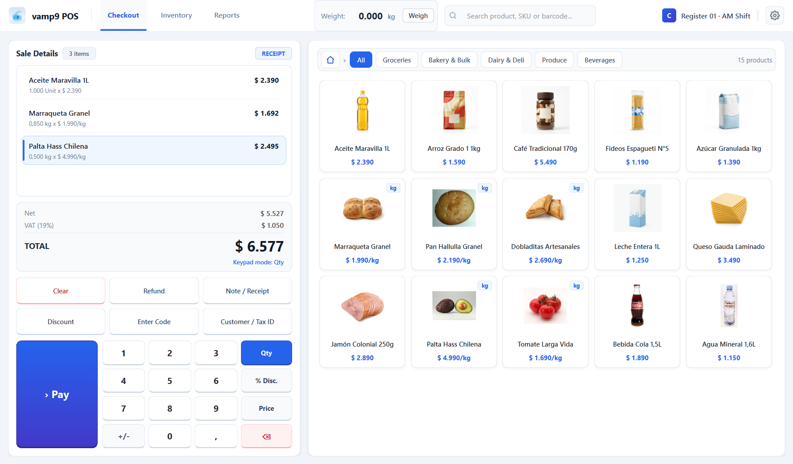
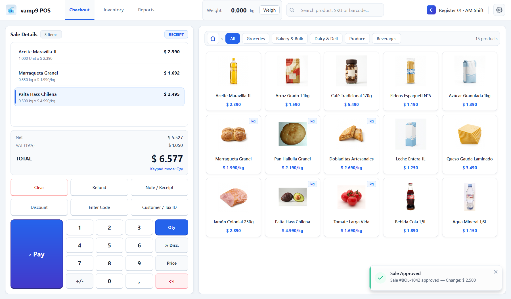
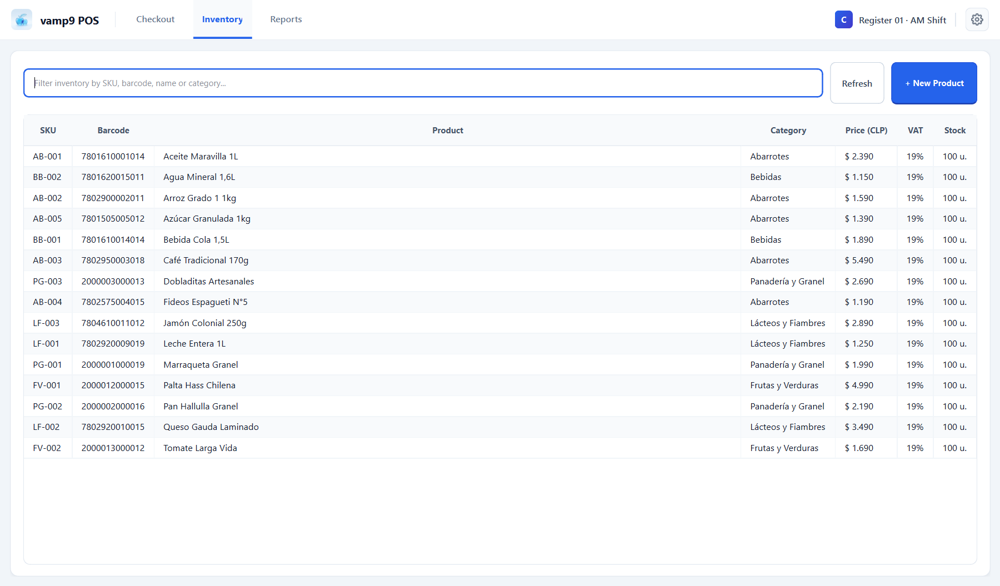
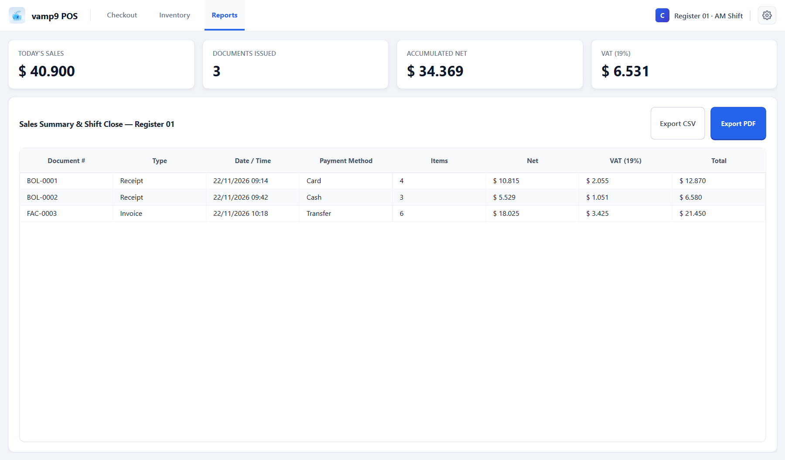
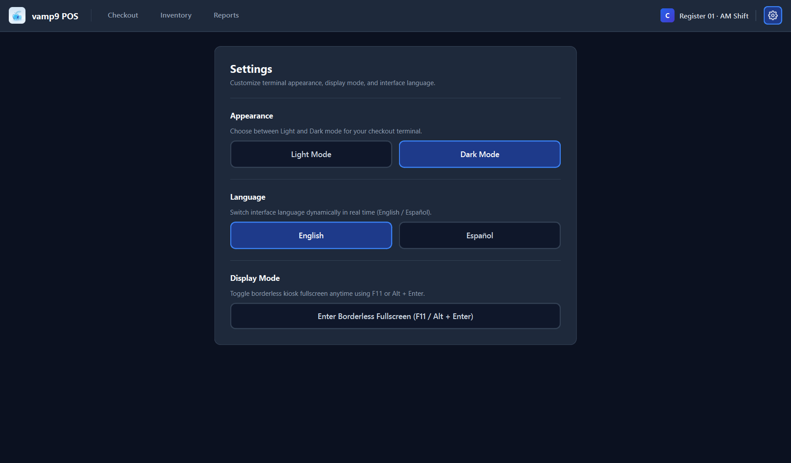

# vamp9 POS

<div align="center">
  
  <br/><br/>
  <strong>Commercial-Grade Offline-First Supermarket Point of Sale System built with C++20, Qt 6 Widgets &amp; SQLite3 (WAL Mode)</strong>
</div>

<br/>

<div align="center">

  
  
  
  
  
  

</div>

---

## Overview

**vamp9 POS** is a commercial retail Point of Sale desktop application engineered with **Clean Architecture** in **C++20** and **Qt 6 Widgets**, modeled after high-throughput supermarket terminals (NCR / GK Software / Odoo POS). It ships with zero console windows, embedded Windows branding, an offline-first SQLite3 WAL database, and a bilingual Windows installer.

### Key Features

- **Commercial Retail Checkout (38% / 62% Ergonomic Split):**
  - Clean minimalist `TopBar` with integrated `0.000 kg` digital scale readout (`Weigh` / `Tare`), quick SKU/barcode search, compact terminal profile, and classic SVG gear settings trigger.
  - High-density two-line itemized receipt (`TicketItemDelegate`) with soft `#EFF6FF` active selection, exact Chilean Peso (CLP) formatting, and deterministic 19% VAT breakdown (`Net + VAT == Total`).
  - Tactile 4×4 physical numpad (`Qty`, `% Disc.`, `Price`, `+/-`, `⌫`), 2×3 quick actions (`Clear`, `Refund`, `Note / Receipt`, `Discount`, `Enter Code`, `Customer / Tax ID`), and a vertical `› Pay` modal supporting Cash, Debit/Credit, and Transfer with instant change calculation.
  - Five-column photographic product catalog (`ProductCardWidget`) dynamically loading real product photography from `assets/products/`.
- **Non-Blocking Glassmorphic Notifications (`ToastManager`):**
  - Frosted translucent floating toast cards anchored to the bottom-right corner (`24px` margin, `24px` drop shadow, `4px` status bar, crisp SVG icons) with `QPropertyAnimation` slide + fade transitions and `3.2s` auto-dismiss.
- **Native USB Laser Barcode Scanner (`BarcodeScannerHandler`):**
  - Global HID Keyboard-Wedge `eventFilter` driven by `QElapsedTimer` (`< 40 ms` inter-key burst detection) that captures rapid scanner reads regardless of focused widget and dispatches instant toast feedback + a synthesized 2500 Hz POS beep.
- **Offline-First SQLite3 (WAL Mode):**
  - Idempotent SQL migrations, ACID local product catalog & live stock validation, and an outbox `SyncWorker` built with C++20 `std::jthread` + `std::stop_token`.
- **Inventory & Shift Reports:**
  - Real-time SKU/barcode/category filtering, product creation modal with custom photo import, live shift KPIs, and one-click **PDF** (`QPdfWriter`) and **CSV** (UTF-8 BOM) export.
- **Borderless Fullscreen & Live Bilingual UI (EN / ES):**
  - Global **`F11`** and **`Alt + Enter`** shortcuts to toggle borderless kiosk fullscreen instantaneously.
  - Real-time **English / Spanish** interface switching (`TranslationManager`) and persistent **Light / Dark** themes (`main.qss` / `dark.qss`).

---

## Screenshots

| Checkout Terminal (Light Mode) | Glassmorphic Toast Notification |
| :---: | :---: |
|  |  |

| Inventory Management | Sales Reports &amp; Shift Close |
| :---: | :---: |
|  |  |

<details>
<summary><strong>Dark Mode &amp; Settings View (Click to expand)</strong></summary>
<br/>
<p align="center">
  
</p>
</details>

---

## Installation (Windows x64)

1. Download **`vamp9-POS-Setup.exe`** from the latest [GitHub Release](https://github.com/lordvamp9/Sistema-Ventas/releases).
2. Run the installer and select **English** or **Español** in the setup wizard.
3. Launch **vamp9 POS** from the Desktop or Start Menu shortcut. Press **`F11`** or **`Alt + Enter`** anytime for borderless kiosk fullscreen.

---

## Build from Source (Windows x64)

### Prerequisites
- **CMake** 3.21+
- **Visual Studio 2022** / MSVC C++20 Build Tools (or Ninja + MSVC)
- **Qt 6.2+** (`Core`, `Gui`, `Widgets`, `Sql`, `Svg`, `Test`)
- **Inno Setup 6** *(optional, for compiling `vamp9-POS-Setup.exe`)*

### Compile, Test &amp; Package

```powershell
# 1. Configure & build Release (WIN32 subsystem — zero console window)
cmake -S . -B build -DCMAKE_PREFIX_PATH="C:/Qt/6.6.3/msvc2019_64"
cmake --build build --config Release --parallel

# 2. Run unit & UI integration tests
$env:PATH = "C:\Qt\6.6.3\msvc2019_64\bin;" + $env:PATH
ctest --test-dir build -C Release --output-on-failure

# 3. Deploy standalone Qt6 runtime into dist/
New-Item -ItemType Directory -Force -Path dist | Out-Null
Copy-Item build\Release\vamp9_pos.exe dist\
Copy-Item -Recurse assets dist\assets
Copy-Item -Recurse database dist\database
C:\Qt\6.6.3\msvc2019_64\bin\windeployqt.exe --release --no-translations --no-opengl-sw dist\vamp9_pos.exe

# 4. Build bilingual Windows installer (installer/output/vamp9-POS-Setup.exe)
ISCC.exe installer\vamp9_pos_setup.iss
```

---

## Architecture

```text
.
├── CMakeLists.txt
├── assets/
│   ├── icons/                  # Brand PNG & multi-resolution Windows .ico
│   ├── products/               # Drop-in product catalog photography (.png)
│   ├── styles/                 # Commercial Light (main.qss) & Dark (dark.qss) QSS
│   └── windows/app_icon.rc     # Windows executable icon & VS_VERSION_INFO resource
├── database/migrations/        # Idempotent SQLite3 WAL schema migrations
├── docs/screenshots/           # Application screenshots
├── installer/                  # Bilingual (EN/ES) Inno Setup 6 installer script
├── tests/                      # QtTest / CTest unit & UI verification suite
└── src/
    ├── main.cpp                # Composition root (DI, SQLite WAL, Logger, UI)
    ├── domain/                 # Pure C++20 entities & repository/hardware interfaces
    ├── application/            # CartService & SyncWorker (std::jthread outbox)
    ├── infrastructure/         # SQLite3 WAL repositories, ESC/POS mock printer, logger
    └── presentation/           # MainWindow, TopBar, ToastManager, TranslationManager & views
```

---

## Author &amp; License

Developed by **vamp9**. Released under the [MIT License](LICENSE).
